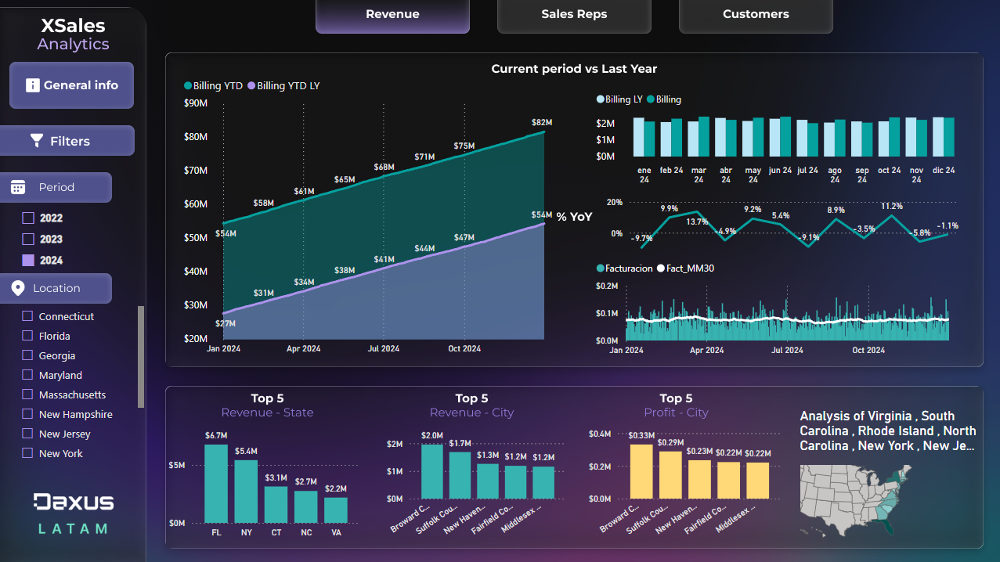
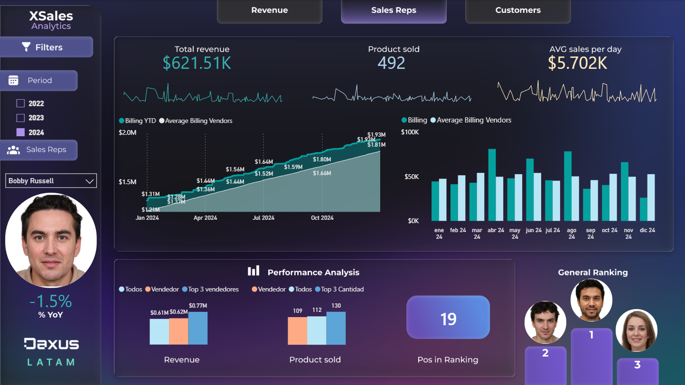
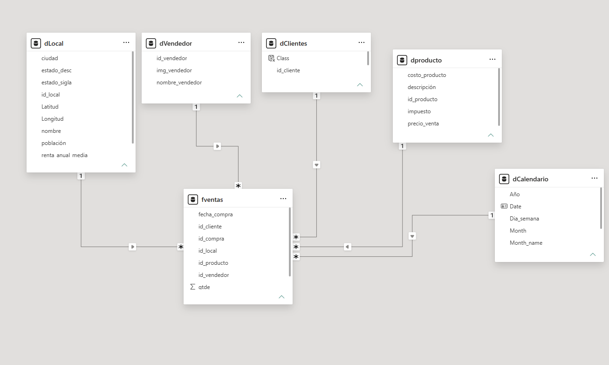

# Xsales Financial Database and Dashboard

# Overview
This project was done to develop a Dahsboard for Xsales fictional company to improve my exploratory analysis, dax measures complexity, dashboard presentation, use of different graphs to support business ideas, focusing on comparing the sales development throughout 2022 - 2024, Sales representatives performance and customers habits. It includes sales across three years, customers purchase habits, sales representatives behaviours and stores performance in various states across the US. The database from which I was able to make this project was given by the educational insitute Daxus Latam, it was all given in an xlsx file, then by doing certain analysis and setting the best graphs to view the business sales, sales reps performance and clients spending habits. 

# Project requirements
1. General Analysis of company revenue by region and period.
It is considered crucial to evaluate a given period in relation to previous years, as well as to analyze the revenue contribution of the regions with the highest sales.
Additional desired analyses: Profit, Profit Margin (%), Average Daily Revenue, and Average Transaction Value.
The dashboard must allow filtering by selected period and region.

2. Salesperson view: revenue analysis by salesperson and period.
In addition to comparing revenue from the current period with that of the previous year,
an analysis of salesperson performance is required, as shown in the following example:
Compare the selected salesperson with the company-wide average and with the top 3
salespeople in terms of revenue and number of orders.
Create a ranking showing the top 3 salespeople by revenue.
The dashboard must allow filtering by selected period and salesperson.

3. Customer View: In this dashboard, you must analyze the structure of the company's customer portfolio.
Status Analysis: Each customer must be categorized based on their status.
Based on the time elapsed between the last purchase and the current date: if the difference is less than 45 days, the customer should be classified as "Active"; between 45 and 90 days, as "Contact Needed"; and 90 days or more, as "Inactive."
Current Date: Use the date of the company's most recent sales record. Profile analysis: Since the only information the company has about its customers is their name, it will be necessary to use purchase record data to create a profile characterization for each customer.
Note: A suggested approach is to use the average annual income of residents in the neighborhood where the purchase was made (information available in the "dLocal - Average Income" table).
New customer analysis: Evaluate the number of new customers for this company over the years. Count only those with no prior purchase records as new customers.
In addition to the general information described above, a query by customer name is required, containing: consumption information, last order, total orders, average order value, and the region(s) where the customer made purchases.
The dashboard must allow filtering by selected time period and by customer name.

# Project Workflow
```
Load xlsx file
        |
Explore the data
        |
Data Preparation
        |
Initial Dax measures for initial kpi's and overview of revenue
        |

```

# Skills & technologies
Technologies: Power BI, DAX
Skills: Data Analysis, data visualization

# Dashboards
The initial dashboards show the revenue for the years '22 to '24, mainly the idea was to compare the current year(2024) vs last year, also the top 5 in revenue for cities, states and the profit. It shows a minimap that has a conditional format that shows a more intense green for the state with the highest sales, also there's a filter for the period and the location. In the section **Interactive Dashboard** you can go to and interact with the dashboard yourself.

*Dashboard of General Analysis of company revenue by region and period* 



*Dashboard of Salesperson performance*


*Dashboard of Customer portfolio*

# Data model diagram
To achieve the desired requirements, I opted to create a dimensional model consisting of 5 dimension tables and one fact table of sales as seen below:


# DAX Measures
To get started on measures I will show how they answer real business questions and the logic behind it. If you want to see the complete list of measures used please go to ______
 
## Business logic
Costo: total cost including taxes

Business question: What does it really cost us to sell what we sold? 
How I came up with this approach: SUMX evaluates row by row, so each sale uses its own product cost and tax rate (via RELATED). Summing the columns first and multiplying afterwards would give a wrong total. Variables keep the two components (product cost and tax) readable and separate.
```sql
Costo =
VAR V_costo_producto =
    SUMX ( fventas, fventas[qtde] * RELATED ( dproducto[costo_producto] ) )
VAR V_impuesto =
    SUMX (
        fventas,
        fventas[qtde] * RELATED ( dproducto[precio_venta] ) * RELATED ( dproducto[impuesto] )
    )
VAR V_resultado = V_costo_producto + V_impuesto
RETURN
    V_resultado
```

## Time intelligence
dCalendario: the date table behind every time calculation

Why it matters: Time intelligence functions need a continuous date table, so I built it in DAX instead of importing one. It starts at the year of the first sale and adds the columns the report needs: month, quarter, weekday, year and a Month_year label that links to the budget table.
```sql
dCalendario =
VAR V_min_date = MIN ( fventas[fecha_compra] )
VAR V_Calendario =
    FILTER ( CALENDARAUTO (), YEAR ( [Date] ) >= YEAR ( V_min_date ) )
RETURN
    ADDCOLUMNS (
        V_Calendario,
        "Month", FORMAT ( [Date], "mmm" ),
        "Month_name", MONTH ( [Date] ),
        "Month_year", FORMAT ( [Date], "mmm" ) & " " & FORMAT ( [Date], "YY" ),
        "Trimestre", "Q" & FORMAT ( [Date], "Q" ),
        "Dia_semana", FORMAT ( [Date], "DDD" ),
        "Año", YEAR ( [Date] )
    )

```
Fact_YTD: revenue accumulated up to the selected date

Business question: How much have we billed so far? 
How I came up with this approach: Instead of DATESYTD, I used ALLSELECTED on the date column. This respects whatever range the user picked in the slicers, so the running total adapts to the selection.
```sql
Fact_YTD =
VAR V_max_date = MAX ( dCalendario[Date] )
VAR V_result =
    CALCULATE (
        [Facturacion],
        FILTER ( ALLSELECTED ( dCalendario[Date] ), dCalendario[Date] <= V_max_date )
    )
RETURN
    V_result

```

Fact_LY and YOY%: same period last year and growth

Business question: Are we growing or shrinking compared to last year? 
How I came up with this approach: DATEADD shifts the exact same period back one year, and DIVIDE handles periods with no prior-year data without throwing errors.
```sql
Fact_LY =
CALCULATE ( [Facturacion], DATEADD ( dCalendario[Date], -1, YEAR ) )

YOY% =
DIVIDE ( [Facturacion] - [Fact_LY], [Fact_LY] )

```
## Advanced patterns
Nuevos_clientes: customers who bought for the first time this year

Business question: Are we acquiring new customers or just selling more to the same ones? 
How I came up with this approach: Set logic. I take the customers in the current year and use EXCEPT to remove everyone who already bought in any earlier year.
```sql
Nuevos_clientes =
VAR V_year_max = MAX ( dCalendario[Año] )
VAR V_clientes = VALUES ( fventas[id_cliente] )
VAR V_clientes_anteriores =
    CALCULATETABLE ( VALUES ( fventas[id_cliente] ), dCalendario[Año] < V_year_max )
VAR V_resultado = COUNTROWS ( EXCEPT ( V_clientes, V_clientes_anteriores ) )
RETURN
    V_resultado

```
Fact_presupuesto: budget without a physical relationship

Business question: Are we hitting the budget? 
How I came up with this approach: TREATAS applies the months selected in the calendar to the budget table as a virtual relationship. The data model stays clean, with no extra relationship needed.
```sql
Fact_presupuesto =
CALCULATE (
    SUM ( Presupuesto[Presupuesto] ),
    TREATAS ( VALUES ( dCalendario[Month_year] ), Presupuesto[Month_year] )
)

```

Top5_fact_ciudad: revenue from the top 5 cities

Business question: How concentrated is our revenue? 
How I came up with this approach: TOPN inside a variable builds the ranked list, then CALCULATE uses it as a filter. The result responds to every slicer on the page.
```sql
Top5_fact_ciudad =
VAR V_top5 = TOPN ( 5, VALUES ( dLocal[ciudad] ), [Facturacion], DESC )
VAR V_top_facturacion_topn = CALCULATE ( [Facturacion], V_top5 )
RETURN
    V_top_facturacion_topn

```

## Storytelling
Dinamico_estado: a title that writes itself

Business question: What is the viewer looking at right now? 
How I came up with this approach: The page title updates with the filters (states and years selected), so the dashboard always says what it is showing, like a caption in a book.
```sql
Dinamico_estado =
VAR V_estado =
    CONCATENATEX ( VALUES ( dLocal[estado_desc] ), dLocal[estado_desc], " , ", dLocal[estado_desc], DESC )
VAR V_anio =
    CONCATENATEX ( VALUES ( dCalendario[Año] ), dCalendario[Año], " ,", dCalendario[Año], DESC )
RETURN
    "Analysis of " & V_estado & " / " & V_anio

```

## What-if analysis
Sim_costo: simulating a cost increase

Business question: What happens to our costs if suppliers raise prices by X%? How I came up with this approach: It reads the value from a what-if parameter, so the viewer moves a slider and sees the impact instantly. It turns a report into a decision tool.
```sql
Sim_costo =
VAR V_costo =
    SUMX (
        fventas,
        RELATED ( dproducto[costo_producto] ) * ( 1 + Costo[Valor de Costo] ) * fventas[qtde]
    )
RETURN
    V_costo

```

# Key Insights

# Interactive Dashboard
